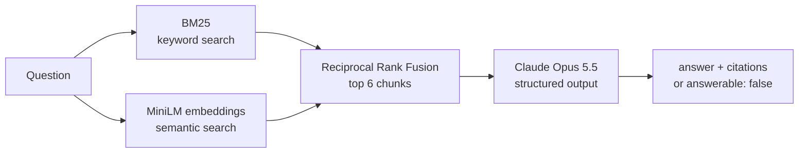

# wp-support-rag

A grounded support copilot for WordPress site owners. It answers questions using only the official WordPress documentation, cites its sources, and says so when the docs don't cover something. The repo also contains the evals I use to measure it: retrieval quality, answer quality, and a check of the grader itself.

I built it because WordPress support is my day job: I've spent 14+ years shipping WordPress sites and currently lead a team that supports ~120 of them. The questions in the eval set are written the way real tickets arrive.

```bash
npm run ask -- "My site shows a critical error and nobody got the recovery email. How do I get back in?"
```

## How it works



- **Corpus:** 37 support articles from [wordpress.org/documentation](https://wordpress.org/documentation/) (troubleshooting, security, users and roles, settings, privacy tools, plugins, updates), fetched through the site's REST API and split into 363 paragraph-aligned chunks of ~900 characters with one paragraph of overlap.
- **Retrieval:** a hand-written BM25 index and local `all-MiniLM-L6-v2` embeddings (transformers.js, no API key), fused with Reciprocal Rank Fusion (k = 60).
- **Generation:** Claude Opus 5.5 returns a schema-validated object (`answerable`, `answer`, `citations`) through structured outputs. The system prompt only allows facts from the excerpts. Citations that don't point to an excerpt the model actually received are dropped. Server-side refusal fallback is enabled.

## Results

### Retrieval

26 answerable questions, top 6 chunks. `npm run eval:retrieval` (no API calls).

| Method | Hit@6 | Gold-doc recall@6 | MRR |
|---|---|---|---|
| BM25 | 88.5% | 84.6% | 0.767 |
| Dense (MiniLM) | 96.2% | 86.5% | 0.804 |
| **Hybrid (RRF)** | 92.3% | **90.4%** | **0.878** |

Hybrid ranks the right document highest and covers the questions that need two documents better. Dense alone finds *something* relevant more often, but lower in the list. With 26 questions these differences are within noise: they show a direction, not a verdict.

### Answers

32 questions (26 answerable, 6 deliberately unanswerable) × 2 runs, graded by Claude Haiku 5.5. `npm run eval:answers -- --reps 2`

| Metric | Result |
|---|---|
| Overall pass rate | **71.9%** (46/64; 95% CI 59.9–81.4%) |
| Required facts covered | 78.7% (96/122) |
| Answers with unsupported or contradicted claims | 2.1% |
| Answers citing a correct source document | 100% |
| Citation precision | 85.2% |
| Correctly declined unanswerable questions | 100% (12/12) |
| Declined questions the docs do answer | 7.7% |
| Cost of the full run | $0.93 answers + $0.03 grading |

A case passes only if the answer conveys every required fact, makes no unsupported claim and cites a correct source. Unanswerable cases pass only if the model declines.

## What the evals taught me

**The first grader was wrong, and the eval caught it.** The first run scored 45%, with "unsupported claims" in 56% of answers. Reading the failures showed that the judge was flagging paraphrases and even claims it described as "supported" in its own reasoning. I changed the judge to label each claim (`supported`, `reasonable_inference`, `unsupported`, `contradicted`) and to count only the last two. Before trusting it again I ran `npm run eval:judge-check`, which confirms on a sample of cases that the judge:

- passes a correct answer;
- fails an empty answer, "I don't know", and an answer to a different question.

That check also caught a badly worded gold fact (q01) and a flaw in my own oracle answer. Both are fixed.

**The model is faithful; most remaining failures start in retrieval.** Unsupported claims are near zero and every unanswerable question was declined, including "can I schedule a post?", which the model knows but these 37 articles don't cover. Of the 18 failing runs:

- **Retrieval missed the source (q03, q26, part of q12).** The right document wasn't in the top 6, so the model correctly said the docs don't cover it. Example: "404 on every post after changing the link format" retrieves maintenance and reading-settings articles instead of the permalinks FAQ.
- **Retrieval found the document but not the paragraph (q01, q19, q24).** The answer is right but incomplete: it misses the FTP fallback, the bulk-edit option, or rotating hosting and database passwords.
- **Generation left out a detail it had (q06, q21, q22, q28).** Examples: it never says to clear the browser cache, or it gives a 20-character example without stating the 20-character minimum.

**Next steps, in order of expected impact:**

1. Query rewriting or multi-query retrieval for symptom-style questions.
2. A larger k with a reranker.
3. Retrieving whole sections instead of fixed-size chunks.
4. A prompt nudge to cover every applicable fix.

Each step will be measured against this baseline, with more reps, because ±11 points of noise is too wide to judge small prompt changes.

## Eval design notes

- **Gold answers are checkable.** Every required fact carries an `evidence` quote, and the loader refuses to run unless that quote appears verbatim in one of the case's gold documents. The cases were drafted with Claude from the source articles; a sample was spot-checked by hand, and the evidence check keeps every fact anchored to the docs.
- **Both directions are covered.** Six questions are realistic WordPress questions that the corpus doesn't answer (WooCommerce, Elementor, multilingual plugins, analytics, Mailchimp, scheduling). An assistant that answers everything can't score well.
- **Atomic grading.** Each fact is graded separately, and faithfulness is graded separately from completeness, so a failure says *why* it failed.
- **Infrastructure errors are not model failures.** API errors, truncation, refusals and unparseable output go to `errors.jsonl` and are never scored as wrong answers.
- **The grader is a different model** (Haiku 5.5) from the one under test (Opus 5.5) and is told to treat the answer as data and not reward length.
- **Cost is computed from API usage**, including cache reads and writes, separately for the answers and for grading.

## Run it

Requires Node 22+ and an Anthropic API key.

```bash
npm install
cp .env.example .env          # add ANTHROPIC_API_KEY
npm run setup                  # fetch the 37 articles and build the index (~20 s, no API calls)
npm run ask -- "How do I stop spam comments on old posts?"

npm run eval:retrieval         # free
npm run eval:judge-check       # ~$0.01
npm run eval:answers -- --reps 2   # ~$1
```

The documentation corpus is not committed. `npm run fetch` downloads it from the WordPress.org REST API, and each chunk keeps its source URL.

## Layout

```
src/        chunking, BM25, embeddings, hybrid retrieval, answer generation, CLI
scripts/    fetch the corpus, build the index
evals/      cases.jsonl, retrieval eval, answer eval, LLM judge, judge sanity check
evals/results/  latest run: per-case rows, errors, summaries
```

## License

MIT for the code. WordPress documentation content belongs to its authors at WordPress.org and is downloaded at build time, not redistributed.
